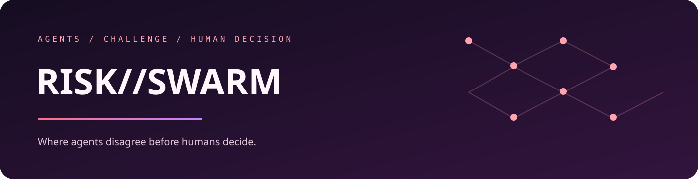
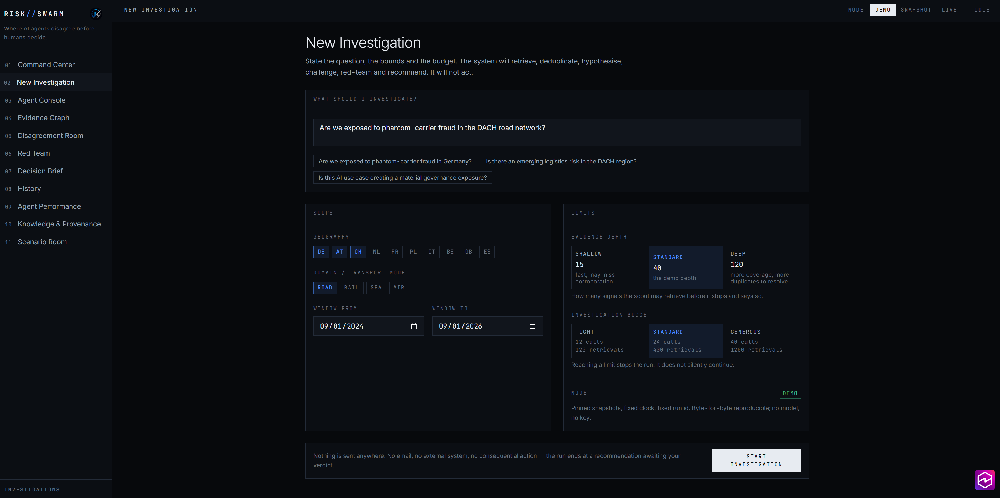
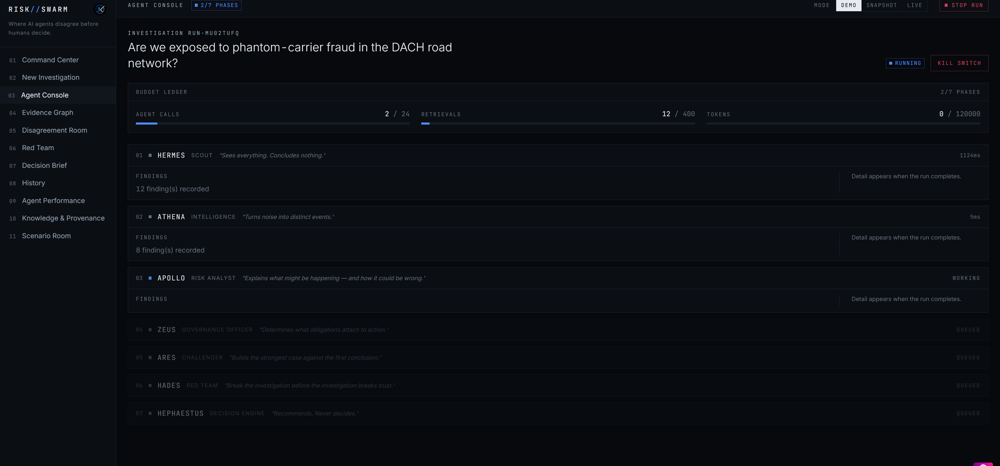
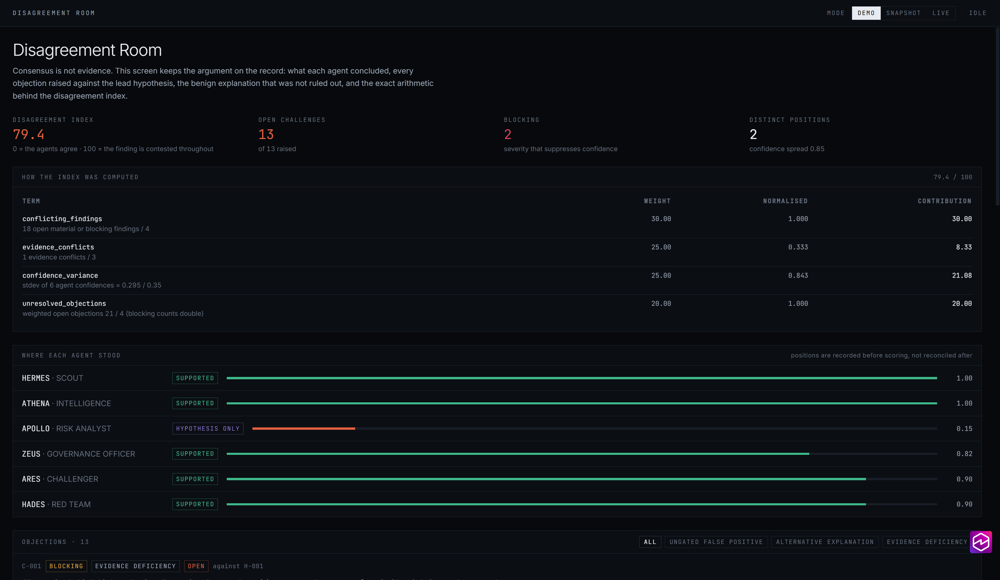
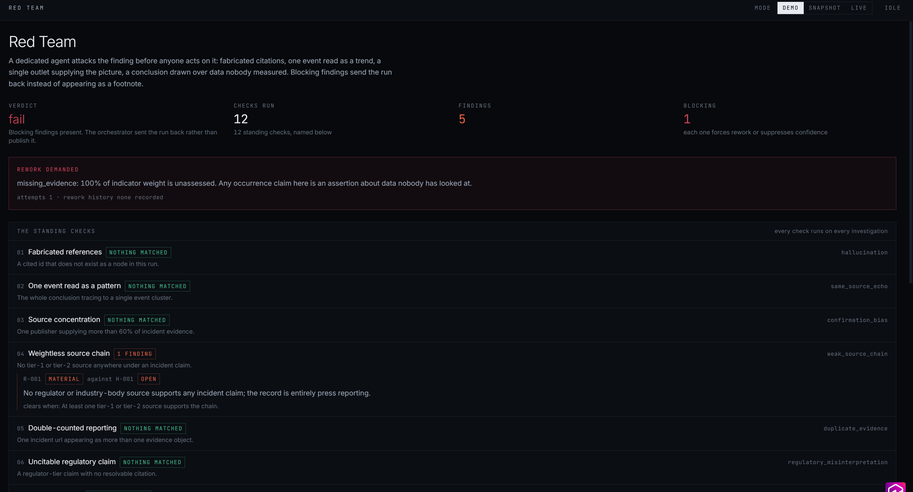

<p align="center">
  
</p>

<p align="center">
  <a href="https://jeevan-0508.github.io/risk-swarm/">Open the command center</a> ·
  <a href="#the-investigation-flow">Investigation flow</a> ·
  <a href="#run-locally">Run locally</a>
</p>

# RISK//SWARM

### Seven agents investigate, challenge one another, and hand a traceable recommendation to a human.

RISK//SWARM is a visual investigation room for consequential decisions. It makes the evidence, agent roles, disagreements, red-team attacks, and final human decision visible in one place.

`MULTI-AGENT` · `ADVERSARIAL REVIEW` · `PROVENANCE` · `HUMAN DECISION`

## Start with the product

**[Open the live command center →](https://jeevan-0508.github.io/risk-swarm/)**

Pick a scenario, watch the agents build their case, inspect the disagreement, and challenge the recommendation before accepting or rejecting it. The product is designed to make uncertainty legible—not to turn a model output into an automatic decision.

## The investigation flow

<p align="center"></p>

<table>
  <tr>
    <td width="50%"><br><strong>1 · Frame the question</strong><br>Choose the scenario and give the investigation a concrete decision to answer.</td>
    <td width="50%"><br><strong>2 · Let the agents work</strong><br>Read the independent evidence gathering and reasoning as it happens.</td>
  </tr>
  <tr>
    <td width="50%"><br><strong>3 · Inspect disagreement</strong><br>See where agents disagree, what evidence they cite, and what remains unresolved.</td>
    <td width="50%"><br><strong>4 · Red-team the call</strong><br>Stress the recommendation before a human records the final decision.</td>
  </tr>
</table>

## Why it matters

Most agent demos show the answer. RISK//SWARM shows the work around the answer: who argued what, which evidence supported it, where the case is weak, and what a human chose to do.

<details>
<summary><strong>Technical notes</strong></summary>

The app is a browser-first React and TypeScript experience with deterministic scenario data and explicit provenance. It is a portfolio demonstrator for inspectable multi-agent workflows, not an autonomous decision-maker or a claim of production deployment.

</details>

## Run locally

```bash
bun install
bun run dev
```

## Related systems

[RISK//MESH](https://github.com/Jeevan-0508/Risk-Mesh) · [RISK//REPLAY](https://github.com/Jeevan-0508/risk-replay) · [POLICY//AUDIT](https://github.com/Jeevan-0508/policy-audit)

<p align="center"><sub>Built by <a href="https://github.com/Jeevan-0508">Jeevan Siddhabhaktula</a> · MIT licensed</sub></p>
